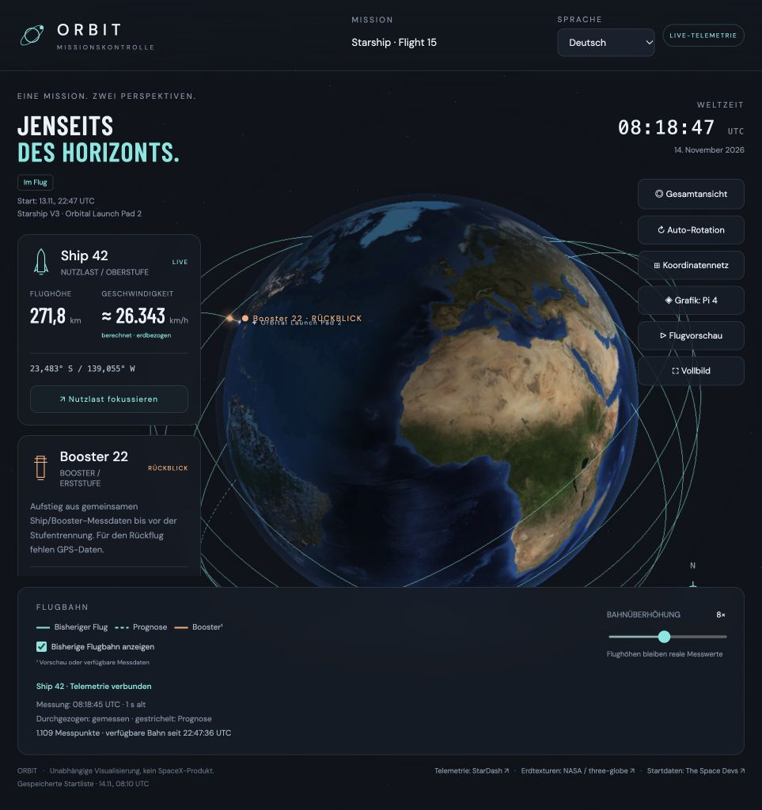
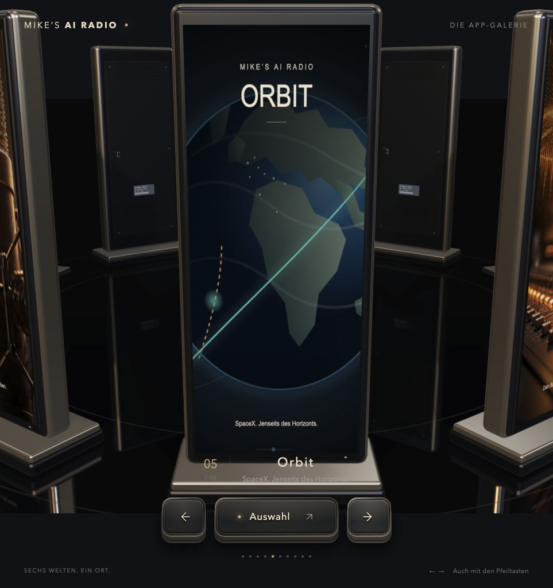

# ORBIT · SpaceX Mission Control

Interaktiver 3D-Erdglobus für Starship-Missionen: Flugbahnen verfolgen, Telemetrie verstehen und Nutzlast sowie Booster aus zwei Perspektiven betrachten. Für Desktop, Touch-Geräte und den Raspberry Pi 4.

**[App öffnen](https://ai-radio.cc/orbit/)** · **[Handbuch](docs/handbuch.md)** · **[Entwicklung](docs/entwicklung.md)**



*Projektaufnahme vom 14. November 2026. Angezeigte Telemetrie ist eine Momentaufnahme; einzelne Bedienelemente können vom aktuellen Build abweichen.*

## Was ORBIT bietet

- **Interaktive Erde:** Tag-/Nachtseite, Zoom, freie Rotation, Koordinatennetz und Vollbild.
- **Flugbahnen mit klarer Herkunft:** gemessener Verlauf, Feed-Prognose und optionales Booster-Schema werden getrennt dargestellt.
- **Telemetrie:** Höhe, Koordinaten und Geschwindigkeit; aus Messpaaren berechnete Werte sind gekennzeichnet.
- **Missionen:** Starship Flight 15 mit angebundener Flugbahnquelle sowie eine Vorschau auf die nächsten fünf geplanten SpaceX-Starts.
- **Sechs Sprachen:** Deutsch, Englisch, Spanisch, Französisch, Mandarin und Portugiesisch.
- **Einfacher Betrieb:** eine gebündelte HTML-Datei mit lokalen Texturen, Schriften und Three.js; Node.js wird nur zum Bauen benötigt.
- **Versionsprüfung:** geöffnete Seiten prüfen regelmäßig auf einen neuen Build.

ORBIT ist ein unabhängiges Projekt und keine offizielle SpaceX-Anwendung.

## Schnellstart

Die fertige `index.html` ist bereits enthalten. Repository klonen und lokal starten:

```sh
git clone https://github.com/MichaelHein65/orbit.git
cd orbit
python3 -m http.server 8080 --bind 127.0.0.1
```

Anschließend **http://localhost:8080** im Browser öffnen. Ein aktueller Browser mit WebGL ist erforderlich. Alternativ lässt sich `index.html` direkt öffnen; ein Webserver ist für Datenabfragen und Versionsprüfung zuverlässiger.

Die Oberfläche kann offline dargestellt werden. Aktuelle Telemetrie, Archive und Starttermine benötigen eine Internetverbindung; offline stehen nur vorhandene lokale beziehungsweise eingebettete Daten zur Verfügung.

## Bedienung auf einen Blick

| Aktion | Bedienung |
| --- | --- |
| Erde drehen | Maus oder Finger ziehen |
| Zoomen | Mausrad oder Pinch-Geste |
| Fahrzeug verfolgen | Nutzlast oder Booster fokussieren |
| Verfolgung beenden | Erde manuell drehen |
| Mission und Sprache ändern | Auswahl im Kopfbereich |
| Booster-Aufstieg ansehen | Rückblick mit Play/Pause und Schieberegler |
| Höhen deutlicher darstellen | Bahnüberhöhung zwischen 1× und 16× |

Zahlenwerte bleiben bei der Bahnüberhöhung unverändert. Die Flugvorschau zeigt illustrative Beispielbahnen. Details zu Touch-Bedienung, Schema und Datenalter stehen im [Handbuch](docs/handbuch.md).

## Messung, Prognose oder Schema?

| Darstellung | Bedeutung |
| --- | --- |
| Türkis, durchgezogen | Verfügbare gemessene Nutzlastbahn |
| Türkis, gestrichelt | Prognose aus dem Telemetrie-Feed |
| Orange, durchgezogen | Gemeinsamer gemessener Aufstieg oder vorhandene Booster-Messdaten |
| Orange, gestrichelt | Optionales, unbestätigtes Rückflugschema |

Nach 30 Sekunden alten Daten oder bei Verbindungsproblemen wird der letzte Datenstand angezeigt. ORBIT extrapoliert keine Messpositionen. Für den Booster liegen nach der Stufentrennung derzeit keine eigenen verifizierten Positionsdaten vor. Das optionale Schema ist keine GPS-Aufzeichnung.

## Selbst bauen

Voraussetzungen: eine aktuelle Node.js-LTS-Version mit npm; Python 3 für den lokalen Webserver.

```sh
npm ci
npm test
npm run build
npm start
```

Der Build erzeugt `index.html` und `version.json`. Auf dem Raspberry Pi werden für die Anzeige kein npm und kein Node.js benötigt. Hinweise zu Kioskmodus und Bereitstellung stehen im [Handbuch](docs/handbuch.md#raspberry-pi-4).

## Einbindung in AI-Radio

ORBIT ist über die [AI-Radio-App-Galerie](https://ai-radio.cc/karussell/) erreichbar. In der App führen eigene Symbole zurück zur Galerie und zu AI-Radio.



*Projektaufnahme der Galerie; deren Inhalte können sich ändern.*

## Weiterführende Dokumentation

- [Handbuch](docs/handbuch.md): Bedienung, Datenquellen, Grenzen, Raspberry Pi, Deployment und Cache-Verhalten.
- [Entwicklung](docs/entwicklung.md): Projektstruktur, Build, Tests und Erweiterung um Missionsdaten.
- [Drittanbieter-Lizenzen](THIRD-PARTY-LICENSES.txt): Three.js und ergänzende Lizenzhinweise; Schrift- und Texturlizenzen liegen in `assets/`.

Die Darstellung wurde im Desktop-Browser und mit emulierter Touch-Eingabe geprüft. Ein Hardwaretest auf einem physischen Raspberry Pi 4 und iPhone steht aus.
